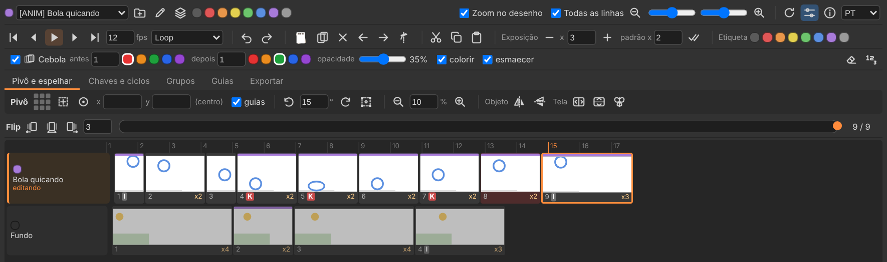

# Pegbar by Coffee Cat

**Frame-by-frame animation for Photoshop 2025 / 2026.**
A free UXP plugin made by an animator, for animators: a TVPaint-style timeline, onion skin, flipping, exposure control and drawing tools that Photoshop is missing.

> 🇧🇷 **Português:** veja o [manual completo em português](LEIA-ME.md).

---

## Features

**Timeline**
- Thumbnails of every drawing; cells grow with the exposure (on 1s, 2s, 3s…), like an X-sheet
- New, duplicate, delete, move, cut / copy / paste frames
- **Default exposure**: set "on 2s" once and every new frame follows it; apply it to all frames in one click
- Color labels for frames and for whole animation groups
- Several animation groups per file (rough, clean, character A, B…), with rename

**Seeing the motion**
- **Play on the canvas**, at the real fps, respecting the exposure (drops frames to keep timing on heavy files)
- **Flip slider**: drag to flip through the drawings on the canvas
- **Onion skin**: frames before/after, a color for each side, opacity and fade-out

**Drawing tools**
- **Pivot / anchor point per layer**: set it from a selection, from 9 preset points or by typing x/y; shown with guides
- Rotate and scale **around the pivot** in fixed steps
- Mirror the selected object horizontally or vertically **using the pivot as the axis**
- Mirror the whole view or turn it upside down to check the drawing (press again to go back)
- One-click access to Photoshop's paint symmetry for mirrored drawing

**Languages**
- Portuguese, English and Spanish — pick it at the top of the panel (it starts in Photoshop's language)

**Shortcuts**
- In the panel: ← → or , . (prev/next), Space (play), N (new), D (duplicate), + / − (exposure), O (onion skin), Ctrl+X/C/V
- Anywhere in Photoshop: every main action is in **Plugins › Pegbar by Coffee Cat**, so you can assign your own keys in *Edit › Keyboard Shortcuts*

## How frames are stored

Plain Photoshop layers, so files stay readable without the plugin:

- An animation is a **layer group whose name starts with `[ANIM]`**
- Each layer inside it is one drawing; the **bottom layer is frame 1**
- Exposure lives in the layer name: `F003 [x2]` = frame 3 on 2s
- Labels are Photoshop's own layer colors

Keep the paper/background **outside** the `[ANIM]` group and draw on transparent layers.

## Install

1. Download `Pegbar-x.y.z.ccx` from the [Releases](../../releases) page.
2. Close Photoshop and double-click the `.ccx`. Creative Cloud installs it (it warns that the plugin is not from the Marketplace: confirm).
3. Open Photoshop › **Plugins › Pegbar by Coffee Cat › Pegbar**.

**If the .ccx does not install:** install *UXP Developer Tools* from Creative Cloud, turn on *Preferences › Plugins › Enable Developer Mode*, then **Add Plugin** › choose `plugin/manifest.json` › **Load**.

Requires Photoshop 2025 (v26) or newer, Windows or macOS.

## Tips

- In *Preferences › History*, keep **"Make layer visibility changes undoable"** unchecked, otherwise play and flip fill the History panel.
- Use **Clear onion** before exporting or sending the file.

## Support the project ☕

Pegbar is free. If it saves you time, you can [buy me a coffee](https://buymeacoffee.com/studiocoffeecat). It helps me keep it working with new Photoshop versions.

## Credits & license

Made by **Danila Ribeiro** — 2D/3D animator — at **[Coffee Cat Studio](https://coffeecat.com.br)**, São Bernardo do Campo, Brazil.
Released under the [MIT License](LICENSE).

Photoshop is a trademark of Adobe. Pegbar is an independent project, not affiliated with Adobe.
